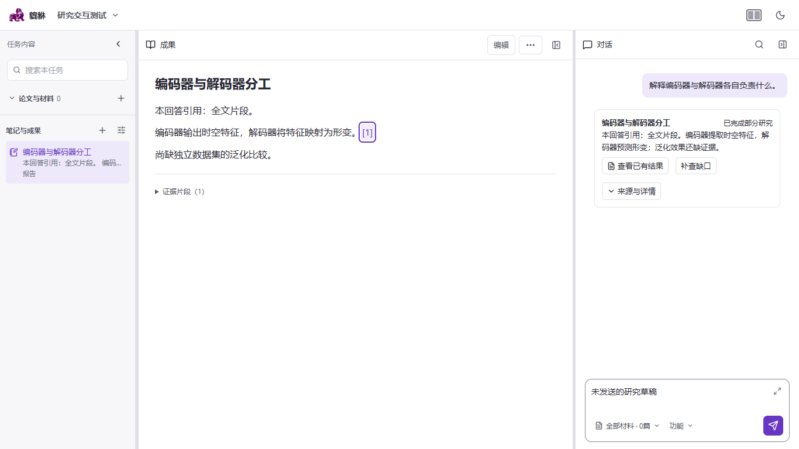
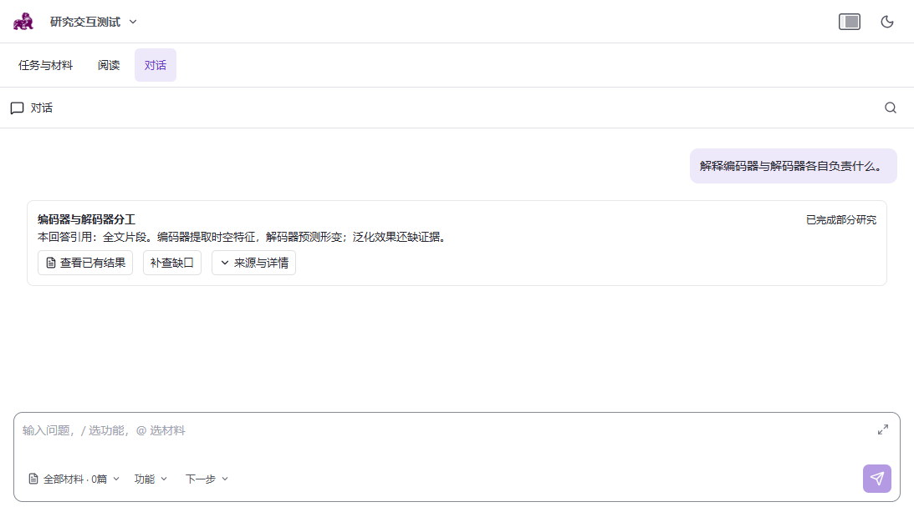

# 当前研究工作台界面回归

本轮验证当前源码，仓库提交c0bd84ad，最近前端提交c7f5b386；源码及测试文件摘要保持。没有修改前端生产源码，没有纳入并行交互任务的三个脏文件，没有发送模型请求或写入真实任务数据。

## 已验证

- 完整前端测试脚本通过：19组Node模型测试及67个Vitest文件、501项Vitest检查通过；类型检查通过。
- 生产构建通过，生成目录确认位于项目内普通frontend/dist；没有部署。构建仍报告大于500KB的分块，本轮不把构建成功当作启动性能通过。
- 使用已安装的无头Chromium、独立4273端口，运行当前真实工作台的6个封闭API浏览器案例，全部通过，0重试、0失败、0跳过。所有非预期API和外网请求被拦截，不连接用户研究服务。
- 暂停状态不会定时重发操作，窗口重新聚焦只读取状态；1366×768、1440×900、1093×614、1152×720四种CSS视口均没有横向溢出，输入区没有超过既定高度上限。
- 功能与材料弹层的外部点击关闭、Escape关闭及焦点恢复通过；展开输入再关闭后，未发送草稿保持。
- 结果可打开，引用预览包含原句、页码及精确来源链接，关闭后焦点返回原按钮。
- 编辑保存后刷新可以找回，原文保留为历史版本，恢复历史版本后被替换版本仍保留。

## 视觉复核

1366×768结果页正文、折叠证据及输入区可见；1093×614切换为任务/阅读/对话标签布局，结果卡片和输入区保持在视口内。截图使用明确的测试夹具，不是真实研究结论，也不作为内容评分。

## 证据及边界

证据位于 `deep-research-evidence/frontend-current-checks-20261112.json`、`frontend-current-build-20261112.json`、`frontend-workbench-current-20261112.json`、`frontend-current-visual-review-20261112.json`。完整原日志及Playwright报告保留于tmp，截图摘要已归档。

本轮证明当前源码的单元/组件、类型、构建及封闭API工作台交互，没有证明真实Java/Python数据链路中的保存、冲突与恢复，也没有重新验证真实研究生成或学习效果。后续仍需完成真实后端的持久化交互核对及完整DR0—DR5内容与发布验收。用户已省略的完整新手学习流程、独立Edge恢复及旧项目导入不重新列为门槛。
