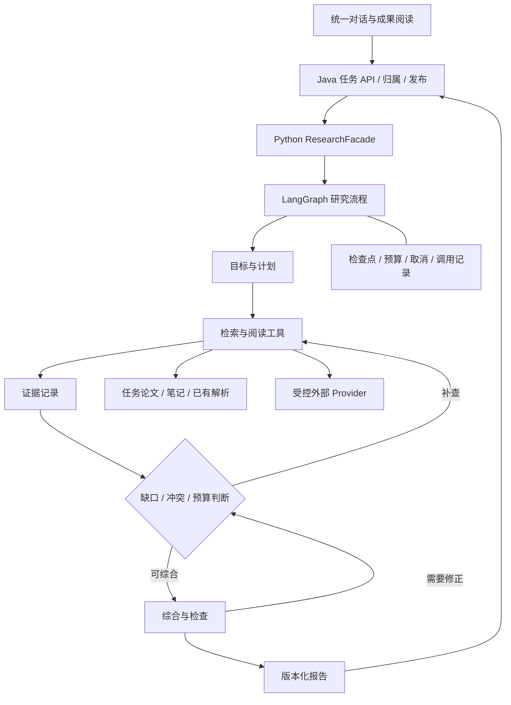

# 学术 Deep Research 完整设计稿

日期：2026-10-12。版本：1.0。状态：待实施的产品与工程设计，不代表功能已经实现或通过验收。

本文承接 `FRONTEND_PRODUCT_DESIGN_20261011.md`、`INTERACTION_DESIGN_20261010.md` 和 `CRITICAL_READING_DESIGN_20261011.md`，专项定义新版深度研究的最终行为。关于研究能力的新增设计以本文为准；其他能力沿用既有规范。外部网络能力的实现还须同步更新既有安全文档并通过对应检查，本稿本身不启用任何网络权限。

阅读路径：产品边界与选型见第 1—4 节；材料与完整交互见第 5—8 节；架构、数据及接口见第 9—13 节；质量、成本和网络策略见第 14—17 节；开发与验收见第 18—20 节。


2026-10-20实施检查点：当前服务`.191`，3,077项完整离线回归通过。H2F-v9在6分钟边界产生一个未知请求并保留暂停，未完成内容验收；H5F-v5实际送入完整定义公式，但方法/数据绑定、初始化与有效抖动测量不合格，未形成可执行方案。短事实初始核验的低推理配置及时间准入尚无真实正向内容证明。原DR0—DR5、独立验收和草稿PR边界保持，详见实施状态与验收矩阵。

2026-10-20成员证据链路检查点：`.194`保留成员表读取/提取/分配改进，新建实验恢复直接生成。`.193`全量3,089项通过；真实H5F-v6单次生成在180秒请求期限未知，没有内容通过。后续拆分有界科学规划与完整配置，保留原整轮预算、全部科学门槛及未知请求身份。

2026-10-20两阶段生成检查点：`.195`已实现持久化的小科学方案与直接完整配置生成，共用原整轮预算和独立审查。完整离线3,122项通过，21个旧实际请求指纹保持；服务加载保持4,732条账本与11个未知暂停。本轮没有新增真实模型调用，不代表实验内容、时延或独立验收通过。详见实施状态。

2026-10-20共享实验修订检查点：`.196`用同一角色语法精简修订输入，完整离线3,142项通过，22个旧请求指纹保持。归档三批在原19,252字节容量内保留全部原对象；未增加真实模型调用。原无引用建议仍不能补选证据，来源忠实修订和内容验收尚未完成。详见实施状态。

2026-10-20实验候选取证检查点：`.197`已增加受实际读取、冻结材料和准确来源版本约束的实验修订候选补选；完整离线3,181项通过，22个旧请求指纹保持。归档输入三批实际带入定义公式，不改变旧结果；本轮无新模型调用，实际方案内容与独立验收仍未完成。详见实施状态。

2026-10-20 E1真实验证检查点：新冻结的3DGStream阶段2开发题只提交一次，规划响应达到6,144输出上限并被拒绝，8次调用结算30,667tokens，无新未知，未发完整配置或修订。实际只有2条正文进入规划，部分草稿存在未经支持的场景假定和NTC替换；需要修复输入前提与规划输出，不能据离线通过宣称内容完成。详见实施状态。

2026-10-20规划输出与固定输入检查点：`.198`新契约4采用直接、较短的私有科学方案并无损压缩重复目标，输出与整轮Token上限不增加；完整离线3,194项通过，23个旧请求指纹保持。E1受控原文从2到7，但共享方法与场景成员取证仍有缺口，本轮无新模型调用，不代表内容验收通过。详见实施状态。

2026-10-22 引用呈现检查点：`.231`只把本条已拥有的明确操作引用改为可读来源归属，保留原文审计，不补选引用或修改配置。4067项完整Deep Research离线检查通过；未新增付费案例，真实实验内容仍未通过。完整范围及独立验收保持，详见实施状态。

2026-10-22 结构化执行规划检查点：新实验私有规划编码3把state变为输入、组件状态清单及前向/转移规则，把pairingBudget变为逐阶段范围、单位、上限、可训练状态和汇总口径。仍保留原4KB规划、32KB请求及18调用/100kToken/360秒整轮上限；不选择默认参数、不将规划作为原文或科学认可。旧编码及未知请求身份保持。详细实现与实际验收见实施状态。

2026-10-22 规划表格表示补充：编码4将私有状态清单按name/dtype/shape/initializer四列、预算阶段按name/appliesTo/scope/unit/cap/trainables/stop七列传递，逐值无损展开留档。模型原始紧凑对象与实际传入正文的元组均受原4KB限制；展开后的内部对象不作为额外模型输入。P/T/Q编号不自动映射成证据，字段层级、原文权限及科学门槛不放宽。

2026-10-22 私有规划传输补充：原生JSON契约10只为plan_experiment采用专用私有英文规划系统指令，要求精确证据编号、字段类型、完整共享/冻结模块及阶段上限；其他节点的系统消息与契约9逐字保持，公开结果继续中文。沿用原1024预留的系统/封装空间，不增加模型请求或总预算。该修复的内容效果需另行真实验证，不能改写既有失败结果。

2026-10-22 私有训练状态清单补充：规划编码5将阶段trainables定义为唯一状态名称列表，正拟合预算须非空、跳过阶段可空；私有steps明确指optimizer_steps（优化器更新），不指视频帧，按原值保留。正式Budget1仍只用原规范单位，来源、4KB容量、配置和科学检查不变。原生JSON11只同步私有规划类型，公开节点消息仍与9逐字一致；声明清单不等于状态存在或科学有效的证明。

2026-10-22 完整私有规划共享表示补充：规划编码6把实际传入正文的规划保持在原4KB内，按精确相等的状态类型和唯一状态名共享重复值。所有状态、阶段、参数和引用逐值保留；同名不唯一或名称未知时保留原字符串，不猜测状态。原始列式回复独立限8KB，模型输出Token上限仍6144；该变化只区分原回复存储与实际正文输入，不扩大32KB请求、18调用/100kToken/360秒或科学门槛。旧版本的原4KB回复门槛及失败身份保持。

2026-10-22 初始化与审核字段补充：执行指引2将初始化输入源明确为training_data、baseline或已声明的前置组件ID；输入相关形状必须引用当前初始化已声明输入，不能照抄语法占位符。审核封装7由实际声明生成字段索引，区分缺失键、已有无效值和仅使用正文的角色，并明确拟议参数与论文事实的不同核验要求。索引不补充参数、不改变原文或配置、不授予科学通过；旧版本请求及未知身份保持。真实内容效果须单独验证。

## 1. 产品目标与完成边界

用户通过对话提出学术问题，系统组织任务材料，按允许范围发现和阅读资料，根据证据缺口调整调查，交付有依据、能继续使用的研究成果。面向新手，但不以简化之名隐藏关键条件和不确定性。

### 1.1 最终必须支持的研究

| 类型 | 典型问题 | 成果要求 |
| --- | --- | --- |
| 方向调研 | 这个方向有哪些路线，应该先读什么？ | 问题边界、方法脉络、代表工作、争议、推荐阅读顺序 |
| 论文比较 | 这几种方法的优势和代价是什么？ | 统一比较维度、成立条件、可比性判断、对用户选择的意义 |
| 主张核查 | 画质几乎不变的说法是否可靠？ | 原始主张、支持与反对证据、适用范围、尚不能判断的部分 |
| 实验设计 | 如何区分剪枝和 SH 降阶的影响？ | 假设、对照、变量、数据与指标、执行步骤、混杂因素、判断标准 |
| 研究切入点 | 这些工作还留下哪些可验证的问题？ | 已有证据、缺口、候选假设、可行性及最小验证方案 |

仅任务材料和补充外部文献均是正式使用路径。外部检索失败时仍能按已取得的材料形成有明确边界的成果。

### 1.2 本次不包含

- 自动运行训练、占用 GPU、执行未知仓库脚本、自动投稿或联系作者。
- 绕过付费墙、保证获得所有论文全文，或用摘要伪装全文阅读。
- 保证选题新颖性、结果正确性、完整覆盖所有相关工作，或承诺通用自主科研。
- 旧研究项目导入、批量迁移历史记录、重写其他功能的前端。
- 再做一套任务层级、独立研究大厅或通用 Agent 配置平台。

完成本文边界，意味着上述研究路径的产品、可靠性和质量门槛通过。生成报告、跑通个别案例、框架接入成功均不能单独证明完成。

## 2. 已确定的产品原则

1. 任务就是工作区，界面统一叫“任务”。材料、对话、研究和成果归属于任务。
2. 当前阅读对象与本轮允许使用的材料分别保存。任务材料默认可用；显式指定优先；“这篇”以当前论文为主。
3. 导航、阅读、对话三栏保持现有结构，研究通过自然语言和 `/研究` 调用。
4. 正文先呈现结果。来源和过程按需展开，影响结论的限制贴近结论。
5. 有依据的短回答优于无依据的完整长报告。允许得出“目前无法判断”。
6. 研究中的自动补查不逐次弹确认；扩大材料权限、重要歧义和增加预算才需要用户作出选择。
7. 研究完成不抢占阅读区、不强制滚动、不要求新手逐条批准专业论断才能保存。
8. 保留已完成的取证和版本；后续问题优先增量研究，避免反复付费重跑。

## 3. 当前实现与改造范围

以下是设计时核对的代码事实，不是新版能力声明。

| 当前实现 | 现有价值或问题 | 改造决定 |
| --- | --- | --- |
| `frontend/src/hooks/useTaskResearch.js` | 已有任务内启动、轮询、取消、恢复和状态发布；统一入口关闭外部搜索 | 保留任务关系和竞态防护，扩展版本化契约 |
| `frontend/src/components/ConversationResearch.jsx` | 已有对话内研究卡片、计划和终稿确认 | 改为紧凑状态与结果摘要，人工审阅变为按需动作 |
| Java `TaskResearchService`、`TaskWorkspaceController` | 已有归属校验和成果发布；外部能力受限 | 保留业务边界，增加快照、策略、版本与发布幂等 |
| Python `research_task_service.py` | 已有 SQLite 持久化、执行取消和请求幂等；动态追加问题上限为一次 | 以适配器接入新版图，统一执行状态与预算 |
| `research_executor.py` | 当前论文判定足够时可能不检索其他允许论文 | 按研究义务决定覆盖，不把单篇命中视为总问题完成 |
| `research_aggregator.py` | 现有最终报告主要组织子问题摘要 | 新增跨问题综合与核验，保留旧版读取路径 |
| `requirements.txt` | 已声明 LangGraph、向量检索和 BM25 相关依赖 | 先做兼容验证并锁定版本，不直接整体升级 |
| `FEATURE_DEMO_20261010.md` | 研究演示曾完成，但多论文覆盖和实验设计深度仍需改善 | 作为基线案例，新增未参与调试的验收材料 |

## 4. 开源选型与复用策略

核对日期：2026-10-12。仓库状态与依赖可能变化，正式接入时记录 tag/commit、许可证、依赖清单、兼容结果与替代方案。

| 项目 | 当前依据 | 采用方式 | 不直接继承的内容 |
| --- | --- | --- | --- |
| [LangGraph](https://github.com/langchain-ai/langgraph)，MIT | 有状态编排、检查点、中断和恢复基础 | 唯一研究流程主干，持久化适配现有 Python 服务 | 不要求购买托管服务，不把框架恢复等同于外部请求恰好执行一次 |
| [PaperQA2](https://github.com/Future-House/paper-qa)，Apache-2.0 | 面向科学文档的检索、证据收集和引用回答 | 对证据组件做隔离试验；通过统一适配器复用有效部分 | 不叠加第二个自主研究主管，不复制整套论文库 |
| [GPT Researcher](https://github.com/assafelovic/gpt-researcher)，Apache-2.0 | 搜索、页面资料获取、递归研究 | 选择性封装搜索/获取组件，先与现有 Provider 比较 | 不直接发布其通用报告，不绕过本项目证据和网络策略 |
| [Open Deep Research](https://github.com/langchain-ai/open_deep_research)，MIT | 仓库显示于 2026-08-21 归档；包含主管和研究节点组织 | 固定代码快照作为计划、补查与压缩的实现参考 | 不作为持续维护的整包运行依赖，不照搬自动重试设置 |
| [DeerFlow](https://github.com/bytedance/deer-flow)，MIT | 当前 2.0 面向通用长任务 Agent，含沙箱和子任务能力 | 参考长任务、文件成果和状态体验 | 不整体替换现有前后端；沙箱执行留在后续范围 |

最终架构为 LangGraph 加本项目研究领域模块。PaperQA2/GPT Researcher 必须证明在质量、成本或开发量上有收益才进入运行依赖；不能只因功能名称相似就引入。接入失败可保留其设计思路，以既有组件实现同一工具契约。

第三方代码保留许可证及要求的声明；本项目修改部分有明确边界。依赖锁定与升级在单独提交中完成。

所有第三方组件内部的模型调用、外部请求、递归和重试也必须进入统一调用账本。无法关闭隐式重试、无法限制访问目标或无法取得用量的组件，不进入正式路径；不能只统计最外层一次工具调用而漏掉内部费用。

## 5. 材料、焦点与外部范围

### 5.1 三个独立概念

- `allowedMaterialRefs`：本次允许使用的任务论文、笔记与成果版本。不得越过任务边界访问全库。
- `focusPaperIds`：问题主要研究的论文。可以为空、一个或多个；必须包含在允许材料的论文中。
- `readerPaperId`：界面当前阅读的论文。启动时可用于解释“这篇”；启动后切换论文不改变正在运行的研究。

解析优先级：本轮显式材料与对象 > 本轮明确单篇语义和当前论文 > 任务默认材料。若用户要求“只用这篇”，允许范围也收束到该篇；“以这篇为主”允许使用任务内其他相关材料。

| 场景 | 最终行为 |
| --- | --- |
| 当前读 A，问“这篇的主张可靠吗” | A 为焦点，任务其他允许材料可作必要背景 |
| 当前读 A，显式选择 B 并问“这篇” | B 优先，输入区提示“主要参考 B” |
| “比较任务中的两篇” | 两篇均为比较对象，不能因 A 已命中就跳过 B |
| 任务有多篇，无当前论文，问“这篇” | 澄清对象，保留原输入，不随机选择 |
| 问通用方向且任务无材料 | 仅在已允许外部研究时可运行；否则引导添加材料或开启外部范围 |
| 中栏打开成果 | 保持上次主动阅读焦点；成果只在被允许或显式指定时作为材料 |
| 点击来源跳到 B | 属于证据预览；不静默改写已发送问题的材料范围 |

### 5.2 两种对用户可见的资料范围

- **仅任务材料**：默认。只使用启动时选定的材料版本及其已授权解析数据。
- **补充外部文献**：在同一范围控件中选择；任务材料仍保留，允许受控发现、获取及阅读外部学术资料。

用户开启外部范围后，系统可在这一轮预算内自动查找和读取允许类型的公开学术资料，不对每篇重复询问。后端 Provider 未配置或能力未上线时明确不可用，不能切回本地却显示“已联网研究”。任意网页抓取、上传全文到新服务等能力由独立策略限制，不能由模型自行开启。

外部检索获得的论文先进入本次研究的来源集合，不自动填满左栏。用户在来源详情选择“加入任务材料”后才进入任务论文列表；不可获取全文时只加入元数据条目并显示状态。去重时保留预印本、正式版及不同版本关系，不静默合并不同结果。

### 5.3 笔记与旧成果作为材料

用户笔记和 AI 旧成果可帮助理解目标和形成查询，不自动升级为论文证据。关键论文事实应回查原始来源。无法回查时注明“来自笔记/既有成果，尚未核对原文”。笔记中的个人判断、假设与摘录分别保存身份。

材料列表、内容版本与策略在开始时冻结；运行中添加材料不自动扩大本轮范围。被删除、撤销授权或失去访问权限的材料立即停止后续读取和发送；保留必要审计身份，按实际保留权限限制已保存摘录的展示，并提示范围变化。内容更新后的补查建立新的范围快照。

## 6. 完整交互流程

### 6.1 启动与输入

通过 `/研究` 或明确的自然语言研究要求启动。简单解释继续走普通问答，不将每个“为什么”升级成长任务。混合请求“先解释，再研究”在统一对话中承接，解释与研究共用材料身份。

```text
┌ 对话 ──────────────────────────────────────┐
│ /研究 如何区分剪枝与 SH 降阶的质量影响？    │
│                                            │
│ 输入问题……                            [⛶] │
│ [材料 2 篇 ▾]  [/ 功能]               [发送]│
└────────────────────────────────────────────┘
```

材料入口内统一包含已选任务材料、主要参考对象与“补充外部文献”选择，不另放重复的“@材料”和“任务材料”按钮。全屏编辑仅扩大输入空间，保留草稿和选择，不提前发送。Esc 关闭时返回原草稿位置。

研究使用系统默认预算，用户明确要求更详细或涉及长任务时可在展开设置中选择预算档位。普通输入工具栏不常驻模型、搜索深度、并发等技术参数。

### 6.2 自动执行与澄清

研究目标和范围明确时发送即开始，计划默认可查看、可调整。默认不设置“每次必须批准计划”或“必须批准终稿”的流程。

只有以下情况暂停等待用户：对象有实质歧义、问题宽到无法在当前边界交付有意义成果、需要扩大来源范围，或用户要求超出剩余预算继续。一次只询问最关键事项，提供简短选项。用户未答复时保持等待，不以超时当作同意。

```text
你希望主要研究哪一部分？
[已有方法与差异] [可做的实验切入点]
```

### 6.3 执行状态

```text
正在研究：剪枝与 SH 降阶的独立影响
核对消融实验与比较条件       [停止] [详情]
```

状态只包含短标题、当前活动、停止和详情，不同时显示“正在处理/查询状态/正在处理·定位”。不显示无依据的百分比或虚构预计时间。当前活动使用“阅读论文”“补查证据”“整理结论”等用户能理解的名称。

详情在对话栏内展开，有明确的“计划 / 资料 / 执行记录”分区。计划显示待解决的问题和完成状态；资料显示论文身份及全文/摘要状态；执行记录只显示工具活动及结果摘要，不展示模型隐含思考。详情默认关闭，并有明确关闭按钮与 Esc 行为。

调整运行中计划时，先请求在安全边界暂停，再提交带版本的修改。已经发出的调用可能完成；其结果保留审计，但仅在与新计划相关且范围有效时复用。用户修改不与旧计划同时派发新步骤。

### 6.4 完成与结果

```text
建议使用完整四组对照，才能区分独立影响和交互。
当前查到的分阶段结果还不足以直接计算这三项损失。

报告已保存：剪枝与 SH 降阶的消融实验方案
[打开报告]       来源 2 ▾
```

对话摘要由通过检查的报告内容生成，通常 2—4 个短段或一个小表；明确要求简短时服从用户长度。完整报告在中栏阅读，摘要不重复铺完整报告。引用短编号可直接点击，详细摘录折叠。来源数量不作为质量评分。

研究终态自动保存研究成果和状态，区别于普通消息的主动收藏。未完成草稿作为执行记录保存；只有具有可用内容时发布带“部分完成”标记的成果。自动生成的终稿不是“人工已确认”。

后台完成不切换中栏、不打断其他对话、不自动拉到页面底部。用户未在当前结果位置时使用“有新结果”提示。完成后清除常驻运行条，结果留在对应消息及任务成果列表中。

### 6.5 追问与增量研究

完整报告同样提供“继续追问”，提交必须包含新问题；有缺口的报告可“补查缺口”。已确认创建子研究后收起并清空表单，焦点回到入口；结果未确认则保留原问题和请求身份，不自动重发。用户之后再次打开并明确提交是一份新意图。当前用户编辑的父成果以完整标题/正文哈希绑定为未核验背景，不能作为论文证据；旧机器正文和用户保存版本均保留。

新追问的分点要求只来自当前人类问题和本轮补充，不自动继承上一题的“两点/三点”要求；重复原问题时，其明确格式仍有效。字数和其他兼容要求仍按最新人类指令处理。该行为仅新冻结契约生效，旧研究、旧未知请求和原partial结果不改写。追问只新增答案，不能为满足旧点数重讲原来的主题。

| 用户动作 | 处理 |
| --- | --- |
| “解释第二点” | 使用既有证据简短解释，不默认重跑研究 |
| “改成实验清单” | 重组已有报告；不引入新事实时不检索 |
| “补找反对证据” | 派生补查运行，继承有效证据，明确新研究目标 |
| “更新到最新论文” | 新鲜度要求变化，重新检查外部来源，不只返回旧缓存 |
| “只研究 SH 部分” | 收束目标和范围，相关完成步骤复用 |
| “用新加入的论文重新比较” | 创建新的材料快照与派生运行 |

有多个研究结果且“第二点”等指代不清时才询问。补查需要新增调用时沿用本次明确选择的来源策略；若要扩大旧策略则先让用户选择。

### 6.6 保存、编辑、版本与找回

- 导航“笔记与成果”按最近更新显示，研究为筛选类型，不增加独立入口。
- 任务搜索覆盖问题、成果标题、正文和已保存来源元数据。全任务搜索结果标明所属任务；跨任务打开不授予其他任务材料读取权限。
- 每份成果可“定位原对话”；来源可“查看论文原文”。论文页不常驻“返回记录”。
- 新运行生成新的不可变机器版本；用户编辑生成用户版本，均保留来源映射与版本来源。
- 未被用户修改的报告可更新默认机器版本；用户修改过则保留用户版本为当前，提供“查看新版研究”，不覆盖编辑。
- 被用户修改的句子不能无条件继承“已核验”；原来源关联可保留为参考，修改部分标明尚未核验。
- 同一研究的重复状态查询不会重复生成成果、消息或历史版本。

### 6.7 报告与来源布局

```text
导航                  中栏：研究成果                     右栏：对话
论文与材料            消融实验方案       [编辑] [···]     研究摘要……
  LightGaussian       一句核心建议                       [打开报告] 来源 2 ▾
  原始 3DGS           四组实验对照表
                      固定条件与执行步骤                 可以继续问：
笔记与成果            如何判断结果                       把步骤整理成清单
  消融实验方案 ●      必要限制                           （仅相关时展示少量建议）
                      原文依据 ▸
                      未解决事项 ▸                       输入……
```

报告头部只保留短标题和编辑/更多操作，来源属于正文的引用入口；“定位原对话”“下载”“重命名”等在清楚命名的菜单中。不要把正文编辑框、移动任务表单、请求查询按钮全部塞进同一个更多菜单。用户需要理解术语时，选词解释或向对话追问即可，不强制进入学习模式。

```text
来源 [1]  LightGaussian                         [关闭]
位置：第 6 页 · 消融实验表
“用于支持当前论断的必要摘录……”
适用条件：具体数据与设置；未知项明确说明
[查看论文原文]      [加入任务材料]（仅未加入时）
```

引用点击后展开对应证据，标题、位置、摘录和操作有清楚层级。任务论文直接定位已有阅读器；外部全文已保存则打开受控阅读器；只有摘要则显示“仅获取摘要”，提供来源页而非虚构 PDF 页码。关闭证据后回到报告原滚动位置。

过程详情和来源使用各自语义，不能在一个无标题浮层中混排；它们的关闭、键盘和焦点行为统一。删除成果须说明是否仅移除成果；不能因此静默删除原论文或其他成果。

## 7. 成果组织与内容要求

### 7.1 公共结构

所有研究成果按“直接回答 → 关键分析或方案 → 必要限制 → 下一步”组织，来源详情收束。用户要求的成果类型决定正文结构，不强制输出每个模板字段。

每条论断内部区分：论文报告 `reported`、有依据推断 `inference`、待验证假设 `hypothesis`、实验建议 `proposal`。界面使用自然语言表达，避免每句都堆标签。引用编号指向稳定来源记录，不根据当前列表排序改变历史版本含义。

关键结论有相邻引用或明确的推理依据。方法背景知识按需要解释；不在每个报告开头重复完整领域教程。数学公式、表格必须保留必要符号、单位和条件；不靠删掉条件实现简短。

明确要求面向新手的事实性报告，在生成草稿后执行至多一次独立的表达改写；字数已合规也不能据此跳过可读性处理。改写先说明普通动作及后果，再解释必要术语，连接问题或信号、调整对象和后续变化。论断身份、类型、引用及请求要点保持；不能增加来源或把直观例子改成普遍保证。既有契约1继续固定条件及表格绑定。新契约2允许同时整理正文和未核验的条件措辞，删除可选的无依据推算或内部证据代号，将必要限定写一次；原稿和原条件另存审计。可选表值与其绑定可一并省去，保留的值只能选择原绑定，不能更换方法、数据组、指标或单元格身份。全部改写仍须经过原有数字、表格、事实与完整性核验，不以语言流畅或编辑器输出代替科学正确。

此步骤由新版运行的服务端契约开启，旧运行不补跑，实验配置不交给表达编辑。它只使用普通预算并保留核验时间，不增加整轮额度；容量、预算或时间不足时跳过。请求先持久保存，已结算响应直接复用，结果未知仍暂停，不自动重发；坏格式、超长或改变固定字段的响应只保留原稿供独立核验。

### 7.2 四类主要成果

| 成果 | 正文顺序 | 质量底线 |
| --- | --- | --- |
| 方向调研 | 核心判断、路线图或方法表、关键争议、阅读/验证顺序 | 区分综述覆盖范围和整个领域，不按搜到数量决定代表性 |
| 论文比较 | 比较结论、共同维度表、差异原因、选用条件 | 缺项写未查明；不同数据/硬件/设置下的数值不直接排名 |
| 主张核查 | 判断、支持与反对证据、适用条件、未解决事项 | 没有反证时不强凑缺点；未检出不等于论文没有 |
| 实验设计 | 假设、分组表、固定条件、步骤、指标、结果解释、风险 | 明确哪些来自论文、哪些是新方案；不能把建议写成已验证结果 |

比较应先区分条件已对齐、有证据证明不同和当前尚未查明；不能把“可能不同”当作不可比的已成立原因，也不能把共享硬件型号当作全部实验条件已受控。用户提出“为什么不能比较”时，先核对这一前提，再给出有范围的判断。新版跨来源或多行表格数值主张的独立核验还需返回内部比较依据：各自来源/版本的精确引文、对齐状态、是否支持正文结论；若声明条件确实不同，逐侧绑定同一维度的原文值，相同值不能算差异。这些依据只作内部审计，不增加默认正文。结构与引文检查仍不能替代语义核验，不因此自动批准比较。

实验初始化由执行流程统一定义，固定条件引用同一份定义，避免“从头建立组件”与“加载未知检查点”同时出现。训练基线先定义初始状态再按预算拟合；既有基线必须有资产依据。每个新组件列明实际输入、各状态的数据类型/形状、常量/分布/变换初值、随机数实现和种子用途，再把相同完整状态复制到各组。最终评估数据不得用于初始化或选择。正文展示步骤，详细初值默认折叠。

程序检查引用、形状、值域及状态一致性；独立科学核验仍需判断是否列全了所选表示的必要状态，以及初始化、渲染、优化是否兼容。一个字段齐全的方案不能因此被称为可执行。某个必要定义被拒绝后，其依赖项也不能残留为已通过；修订、恢复和发布均使用同一套检查。旧契约保持可读，不把旧结果自动升级为新版本通过。

新实验运行的规划、生成、修订及设计核验共用服务端系统规则：论文事实、方法操作、数据集归属与已发布资产需要自身原文依据；尚未执行的数据划分、超参数、测量和分析选择需要具体、兼容，但不要求作者采用同样设置。核验应读取共享定义，仍拒绝占位模型状态、未知检查点、不完整拟合阶段和矛盾预算。该规则以原生输出契约 v8 冻结进请求身份，预算预留、私有规划指纹与实际 HTTP 发送保持一致；保留现有系统消息预留，不挤占引文。它不构成科学批准，旧请求及非实验任务的输入保持原样。

实验核验封装 v2 保留未通过条目的原稿、条件、类型配置及拒绝原因，供其他条目核对定义和依赖。初次核验保留硬检查未通过项；修订时还保留尚未修好的同伴，已修订条目按身份替换旧稿。它们明确标记为未通过，不作为论文证据、当前核验目标或批准；原硬检查与依赖门槛仍决定能否发布。上下文超限按完整目标拆分，不裁掉必要定义或引文，旧封装 v1 的请求保持原样。

实验修订输入契约 v1 在原生系统规则 v8/v9 下消除重复规则说明，并仅共享同源、同片段中已存在且完整包含其他上下文的原文段落；不拼接片段或推断缺失文字。每条引文仍是原始文字，记录精确上下文窗口及源身份，解码后必需引文、上下文、配置、条件和拒绝检查与原稿一致。分组修订仍受原24,000字节及整轮预算限制，来源权限仅覆盖实际可见的候选；无收益或身份不明时保留原表格。新契约服务端冻结，未知/待发送请求不能切换编码后重发。

新运行的原生输出契约 v9 进一步要求数值字段使用合法 JSON 数值字面量，不允许裸写幂、除法等表达式；公式只能放在结构允许的字符串字段内。保留事实与拟议选择的边界，以及原有系统消息预算。严格解析器不求值、不插入引号、不补写字段；无效输出保留原始响应后失败。v1—v8 请求保持字节一致，不能改变旧运行身份后重发。

实验核验封装 v3 的生产端格式统一为 `{"items":[...]}`，即使只有一个目标也保留列表；完整响应骨架包含每个目标及对应审核槽位，与原生系统规则一致。保留 v2 的未通过共享定义及原因，全部原始目标、引文和来源绑定保持。响应解析、逐目标唯一性和完整性、配置与科学核验仍沿用既有检查，不能把单对象自动包装或把失败改为通过。旧 v1/v2 请求及记录不升级重发。

新运行的实验执行决策指引 v1 要求私有规划先明确实际状态及初始化输入、每个拟合阶段的有限预算和时间范围、完整测量步骤，再形成最终方案。可兼容的拟议超参数应当明确选择，作者默认值缺失不自动变成无法提案的前提。现有精确预算结构不增加字段，各阶段及其合计约束写入具体说明；指标与限制继续使用具体文字，无额外 executionSpec 结构要求。核验封装 v4 从实际数据配置复制划分、种子、独立单元及重复方式的原值和路径，分别标记缺失字段，供审核识别“缺失”和“存在但不合格”。这些记录不计算科学通过，也不替代来源、兼容性或依赖核验。

核验封装 v5 同样约束拒绝理由：每条模型拒绝项需绑定实际目标或共享定义的路径和原值；“字段缺失”只能指向精确结构允许且实际不存在的字段。存在但为空、不兼容或不完整的值须按对应类别解释。无法核对的理由保留原始响应并标为尚未形成可靠判断，不转换为通过，也不作为改写指令；绑定成立仅证明引用了原值，不证明科学判断正确。通过结论继续满足全部原有审核。修订优先级契约 v1 在不拆开原有原子组的前提下，优先处理服务端确定的结构错误；无法核对的模型拒绝项暂不改写，其完整定义仍作为未审核上下文保留。总预算及全组预检不变，排序和冻结身份纳入保存状态，旧待发送或未知请求不能切换策略后重发。

修订优先级契约 v2 还暂缓因容量或执行限制而没有形成有效核验结果的条目（not_started/received_invalid），而不把未审核当成已确认的内容缺陷。它们仍保留在最终缺口和其他目标的未审核上下文中。版本 v1 保持原行为，不能改变已保存请求的目标集。实验编辑仍按实际4096输出上限预留，不扩大普通池或借用最终核验预留；完整输入装不下时仍停止。

核验封装 v6 合并通用科学、工作流、预算和未审核定义的重复服务端说明，完整目标、上下文、证据、来源声明、响应槽位及其检查不变；数据成员与资产来源规则保留原文指令。实验修订输入 v2 同样压缩重复说明与来源注册表后的固定服务端段落，注册表 JSON 及原稿/检查/上下文保持；响应指令统一为 `{"items":[...]}`，每个目标仍必须给出编辑或未解决原因。只替换生成的响应说明，不改写问题中看似格式指令的文字。旧版本请求保持。输入窗口、输出预留、总预算、原子账本以及科学发布门槛均不扩大，受控输入能装下不等于真实内容或余额通过。

私有执行规划与公开成果分开处理。规划编码6保留精确的列式原始回复（紧凑JSON最多8,192 UTF-8字节），模型输出上限仍为6,144 Token；传给正文生成的无损规划元组最多4,000字节，完整正文请求仍最多32,000字节。只有所有状态类型完全相同时才共享其原值；只有某个名称在完整状态列表中逐字唯一时才用索引复用，未知或重名保持原字符串。编码和解码不补状态、不选择参数、不改单位或来源权限，所有值必须逐一还原。8KB回复存储检查与4KB实际规划检查分别执行；任一超限仍保留原响应后停止，不裁掉配置或引用。旧编码的容量及精确待发送请求不升级。

共享规划的原生系统契约12仍只调整私有规划，允许有界原始回复，公开生成/修订/核验消息与9逐字一致。私有规划、声明的状态名、可解析结构及受控输入容量都不构成科学认可；完整方案仍需经过原有初始化、预算、来源和独立语义检查。

### 7.3 实验设计示例：LightGaussian

下面仅是方案示例，不代表原论文提供完整数据，也不代表实验已执行。

| 组别 | 剪枝 | SH 降阶 | 目的 |
| --- | --- | --- | --- |
| B | 否 | 否 | 基线 |
| P | 是 | 否 | 剪枝影响 |
| S | 否 | 是 | SH 降阶影响 |
| PS | 是 | 是 | 联合作用和交互 |

固定数据划分、基线模型或配对检查点、渲染设置、其他压缩开关和评测口径；VQ 固定关闭或保持一致。优化/恢复预算也应控制：若某处理包含恢复训练，其他组应有预算匹配的控制，或另报告算法原生预算结果，两种口径分别解释。对于“SH 降阶”的估计对象，明确是单纯截断、蒸馏流程，还是包含后续优化的整套处理，避免把不同处理当作同一因素。

对于统一定义的标量质量指标 Q，可将基线相对下降写为 ΔP=Q(B)−Q(P)、ΔS=Q(B)−Q(S)、ΔPS=Q(B)−Q(PS)，非加和项 I=ΔPS−ΔP−ΔS。符号随指标方向明确解释；PSNR 等非线性指标上的非加和不自动等于物理误差的因果交互。应配合图像误差、场景间变化和必要重复试验判断。

报告必须给出：如何构建四组、如何控制训练预算、保存哪些配置、测哪些质量/速度/存储指标、怎样解释结果和哪些失败会使比较无效。不能从顺序消融差值直接宣称独立损失或交互损失。

## 8. 前端状态、异常与可访问性

### 8.1 用户状态与动作

| 状态 | 默认文案 | 主动作 | 次动作 |
| --- | --- | --- | --- |
| 排队 | 研究已排队 | 停止 | 详情 |
| 执行中 | 正在研究 + 当前活动 | 停止 | 详情/调整计划 |
| 待澄清 | 需要明确研究范围 | 回答选项 | 修改问题/取消 |
| 暂停 | 研究已暂停 | 继续 | 查看已完成内容 |
| 网络状态不明 | 暂时无法确认研究状态 | 查询状态 | 详情 |
| 已完成 | 直接呈现摘要 | 打开报告 | 来源/继续研究 |
| 部分完成 | 已完成部分研究 + 关键缺口 | 查看结果 | 补查缺口 |
| 无法判断 | 当前材料不足以判断 + 缺少什么 | 查看说明 | 调整范围 |
| 失败 | 本次研究未完成 + 可理解原因 | 查看已保存内容 | 安全可重试时重试 |
| 已停止 | 研究已停止，已完成内容保留 | 查看已有内容 | 从安全位置继续 |

刷新/断线不等于执行失败；先查询服务端状态，再决定是否恢复。用户点击停止后立即显示“正在停止”，禁止派发新调用；无法中断的外部请求可能继续结束，不承诺立即停止计费。

预算耗尽、找不到关键全文等属于可解释的研究边界；有可用成果时呈现部分完成，不用红色通用报错覆盖全部结果。没有任何可靠答案时明确无法判断。

### 8.2 笔记本屏幕与控件规则

- 沿用现有三栏响应式规则。在 1366×768 和 1440×900 屏幕、系统缩放 100%/125% 条件下验证实际 CSS 视口，不假设物理分辨率等于可用空间。
- 普通输入框随内容增长，正文区初始约 56px、最大约 104px；工具栏约 36px。整体以约 180px 或可用视口高度 25% 中较小者为调试上限；更长输入使用右上角全屏编辑。参数须实测调整。
- 执行状态通常不超过两行；详情和来源展开有明确标题、分组、关闭方式，不能覆盖输入区后无从退出。
- 材料、功能及其他浮层统一支持点击外部和 Esc 关闭。关闭后焦点返回触发按钮，键盘可完整操作；全屏编辑使用对话框焦点约束。
- 消息操作在气泡之外，悬停、键盘聚焦或触屏选择时显示。复制、保存等有明确反馈，用户消息按自身内容保存，不被当作 AI 回答配上一轮标题。
- 状态变化使用适度的 `aria-live`，不把每条工具日志朗读给用户；状态和选中项不能仅依赖颜色。
- 收栏按钮表达实际移动方向，论文与右侧对话使用对应方向图标，并提供名称；沿用既有布局控件设计。

## 9. 系统架构与职责



Java 是任务归属、授权、消息和成果版本的业务真源；Python 是研究执行状态、证据和工具记录的真源。Java 保存执行摘要投影，不在另一套状态机里再次运行计划。前端不直接调用研究模型和外部 Provider。

Python 新增逻辑模块建议放入 `services/deep_research/`：`contracts`、`graph`、`planner`、`coverage`、`synthesis`、`verification`、`budget`、`repository`、`tools`。模块边界比目录名重要；先通过 `ResearchFacade` 接入，避免大批同时改动旧模块。

## 10. 研究流程与决策

### 10.1 图节点

| 节点 | 输入 | 输出与约束 |
| --- | --- | --- |
| resolve_brief | 问题、对话关联、材料快照 | 成果类型、目标、假设、待澄清事项；不补造用户条件 |
| plan | brief、材料结构 | 研究义务、问题依赖、完成标准、优先级；不强制固定章节数 |
| acquire | 计划项、允许工具 | 来源候选和稳定身份；权限及预算在调用前检查 |
| read | 来源、目标问题 | 带位置的正文、表格、公式与读取状态；保留原始出处 |
| extract | 片段、研究义务 | 证据及其条件、候选论断；不把摘要改写成精确引文 |
| assess | 已有证据、覆盖记录 | 继续、补查、调整、综合或等待用户，并给结构化原因 |
| synthesize | 经筛选的证据、论断、缺口 | 回答总问题的报告草稿；推断链和引用可回查 |
| verify | 草稿、原始证据 | 硬检查、语义核对、待修复事项 |
| publish | 核验结果、成果契约 | 机器版本、短摘要、结果状态、发布事件 |

### 10.2 研究义务与停止条件

研究义务描述“完成回答必须确认的事项”，包括预期答案形式、相关来源、依赖、重要程度和完成标准。例如比较至少要求双方核心机制及主要条件，不能只因一篇论文命中就完成。

完成状态为 `supported / contradicted / unresolved / not_applicable`，同时记录已查范围。模型自评 confidence 只能作线索，不能独自触发“证据充分”。

正常停止：必需义务已得到支持、被证据否定，或通过明确查证后仍不可判定并已准确表达边界。预算停止：预留综合资源后无法继续，按剩余缺口发布部分结果。无收益停止：有限的针对性补查没有取得新证据，避免循环搜索相同内容。

新版运行将片段检查和覆盖评估分别持久记录。片段检查身份包含原文、页位置、版本及当前问题；空结果、坏格式或截断响应不在下一批里自动重新生成，也不表示论文没有相关内容。同一来源的新页面或新问题仍需检查，已有表格证据不能代替未读过的方法正文。

取证调度契约1先完成当前有限读取池中尚未检查的片段，再发送联合覆盖评估；池的来源权限、12/24条读取上限及每批最多3段保持。中途仅记录“尚未评估”，不把提取收到响应、概述可用或一项就绪当成所有要求通过。预算触顶时仍按实际剩余容量评估已取得证据并发布明确缺口。旧无标记运行保持逐批交错评估和原请求身份。

来源精度契约6以匹配当前检索、且允许引用该论文的冻结完成标准提供逐项提示：输入、时间表示、训练组织不能因出现在同一句里只检索第一项。仍使用同一次本地检索、原索引缓存和五个名额，保留最前命中、已选细节与精确前文；不能跨论文或索引版本补入内容。阅读契约2、提取优先级7按各完成标准排序；主表请求同时照顾测量条件与定量比较片段，不假定Table1必是主表，也不把微基准自动当作总体结果。中文紧邻FPS等技术标识仍应识别；这些提示都不构成事实批准。

提取优先级7可在已授权全文中保留一条明确标注且完整的定义公式，使用原三条提取名额之一；其余至多两条模型摘录优先保留输入、变量和调度定义。公式只通过字面核对，语义状态仍为未检查；模型坏格式、截断或请求未知不因此被记为成功检查。超长、不完整、摘要和笔记中的公式不走该程序保留路径。旧优先级的提取请求和来源身份保持不变。

综合前提契约1按冻结完成标准及来源优先保留前提组，例如初始化与后续联合训练须能一起进入生成输入。仍限20条，默认24KB；新版实验输入契约1的32KB窗口及完整规划预留见15.2。不截断引文。相同来源/版本内的重复表格包共享传递，每条证据仍只能引用自己拥有的表格；事实与比较提示去除重复封装，保留来源、格式和科学约束。只有明确的定性可比性问题且未要求具体数值时，容量不足可省略可选数值表格包并标记tableDataOmitted；原引文、必要方法/条件前提和存储证据保持，不能编造省略包中的单元格绑定。实际提供的证据ID、输入字节及未装入的前提组单独留档；未装入不等于论文或全部已取得材料不存在该事实。

覆盖评估按证据内容/上下文、来源版本和问题建立身份，只复用完全一致的已确认判定。重复、缺失、未知身份或非布尔判定不能关闭缺口。补查是否有收益以证据变化为依据，不只数来源；精确版本要求不能因使用论文基础ID而永远留空。提取触达探索额度边界后，仍可在现有剩余额度内评估已有证据，随后带着缺口综合，不再展开补查。请求在发送前冻结，已结算判定复用，未知请求继续暂停；相关性评估仅决定研究路由，不能代替最终事实和回答完整性核验。

新版取证支持同一完成标准的联合前提：不同论文或同一论文的多条引文可以共同构成就绪依据，不要求每条引文独自回答整个问题。相同人类问题按原完成标准组织，指定的每个来源/版本都须贡献实际引文；来源数量和主题重合不能代替这种关系。请求内共享引文只发送一次，沿用20条证据、24KB输入、1,536输出Token及整轮预算上限。容量不足时减少可选前提，完整原引文和必要来源不截断。条件问题在原候选名额内优先选择已取得的实验设置；选中不等于核验通过。联合就绪只影响继续检索或进入综合，最终事实、数值、来源和回答完整性仍独立检查。旧逐条评估请求及未知调用不改写，已结算联合请求可按冻结身份恢复。

初始机器计划须保留人类原话中的问句及明确的“核查、判断、比较、区分、解释、设计”等交付要求。判断和解释不能降成罗列指标，未验证范围不能消失；列举的比较对象、引号内假设和格式要求不能误拆成新增研究问题。仅在原请求的字面片段内组织完成标准，沿用每项最多4条及原长度上限，不改变材料、依赖和预算；已保存的用户编辑计划及旧运行契约不改写。

明确列出的回答维度须分别核对，例如“作者报告的结果、成立条件和未验证范围”对应三条字面完成标准，各有最终正文依据。科学实体间的对比、引号示例不能当这种维度拆开；若拆开会超过原4条上限，保留完整复合要求，不截掉剩余维度。数值清单不能代替明确判断，已知消融失败不能代替未验证范围，不同实验的条件不能互相挪用。原文可以揭示正文遗漏，但不能代替正文。该结构只防止遗漏或复用错误判定，每项实质是否回答仍由独立语义审计判断。

纯事实回答的修订使用独立简洁提示，只保留人类要求、全部拒绝原因、来源身份、允许引用的完整原引文/上下文和输出格式；实验方案保持专用流程。原失败正文从生成视图省略但完整留档。显示归一化只可删除本条已引用、实际可见且未出现在原文符号中的独立括号E引用标记，保留原响应和逐处记录；未知/未引用代号、公式、代码及实质表述不改写。归一化后的主张仍通过原事实、数值、来源、比较和完整性核验，不能借显示清理放行错误推断。总预算、一次有界修订和未知不重发规则不变。

短事实判断与论文比较可使用有限推理生成：仅新运行、当前有效人类要求明确不超过300字时，由服务端冻结策略启用。综合上限8,192输出Token，低于旧16,384；修订沿用原批次上限，原输入、整轮预算及独立核验保持。实验方案和其他输出不切换。实际选项在预留和请求指纹计算前确定；旧无标记运行的请求保持原样，截断或未知不自动重发。该策略是待真实内容验证的生成改进，不能据此放行结论。

新运行的事实生成先整理当前前提、原文观察、结论强度和未知范围，再写正文；这些草稿元数据单独留档，不能进入报告或充当独立核验依据。生成和修订不额外增加模型轮次。事实核验须另行绑定实际正文的范围原话和本条原文前提，区分有限观察、排他必要条件与普遍断言；在某设置成功或另一些设置失败，不能推出“只有这个设置才成立”。缺少有效范围审计或以有限观察支持更强断言时不得发布。该结构约束不代替语义判断，仍须真实内容验收；旧请求及旧结果不改写。

事实推理契约5仅对明确要求301—700字的多材料比较使用低推理强度，仍沿用8,192输出Token上限；不超过300字的事实/比较保持契约4的配置，其他成果类型不切换。旧契约3/4的高推理请求保持原样。已知生成截断保存为失败，不能自动回退重发或发布残缺JSON；低推理也不代替任何原文、范围和最终完整性核验。

数值拼写契约5将“三维高斯/三维空间”等空间术语与已有3D标签一致处理；特征/向量维数、实际次数及倍数仍须核对，中文倍数按同一倍率单位匹配。维度身份仍交给独立语义核验，不能借标签处理把3D改成4D而自动通过。范围契约3要求核验绑定整条正文并检查全部条件，不能只挑一句真实前缀；缺席范围契约6拒绝用局部引用断言整个任务证据池“未出现/没有”另一篇的信息，也不允许仅凭渲染剖析建立主表归属。正向、限定于实际前提的不确定性仍可表达。新手改写契约8在冻结的新数值/范围策略下先做reported硬检查，再决定是否可改为推断；通过结构或硬检查都不是科学批准。旧契约及未知请求保留原身份。

私有草稿字段须同时在实际综合的claim字段清单和事实专用修订的目标JSON中声明，不能仅追加自然语言指导。新的短事实综合保留有限推理，短事实修订直接返回结构化正文，仍使用原批次额度；策略由服务端冻结，旧有限推理修订的原请求不改写。已收到空正文或无效JSON时保存原响应，不自动重复发送，也不能把它当成论文证据不足。

服务端可信生成提示将人类问题视为研究目标，不将问题里的科学前提视为事实；当前提尚未建立时，正文应先给出有范围的判断，不能先作绝对结论再在末尾否定它。该提示沿用原系统预留，不能挤掉原文或扩大总预算。缺席守卫区分“现有证据未提供某信息”和“论文或作者未提供某信息”：前者须是当前证据直接作主语，进入独立语义核验；“根据现有证据，作者未提供”仍属作者级缺席，不能借范围前缀绕过检查。旧契约和旧请求保持原样。

推断、假设和建议中若声明tableBindings，也必须引用自身原文中真实的行、列与值；更改kind不能绕过已声明单元格的检查。rowNumber使用源行号，不是所选行数组的下标，groupIndex才从零计数。修订可见的行号反馈来自已引用的原文解析结果，路由ID保持别名，不扩张来源。该检查只证明已声明引用有效；合法派生值和未执行选择仍须独立核验，不能强行当作原表报告值，也不能因单元格存在就批准正文解释。

问题之间的证据冲突先核对版本、指标、数据划分、硬件和比较对象，再判断是否真的相反。选择反证查询是为了检查主张，不要求每篇论文必须同时有正反结论。

事实修订契约1仅为新运行压缩事实类修订的生成封装，不改变原始记录或独立核验。完整保留被拒目标的自身引文、原有有界上下文、逐项要求、已接受内容、长度余量及全部拒绝原因；只移除已在同次来源注册表中完全相同的身份/权限元数据，以及上下文中原样存在的重复章节标签。旧核验说明里的E别名属于旧请求，不能被当作新修订的引文权限。入口与实际批次按同一既有输出上限计算输入余量，仍执行总账本、普通池及最终核验预留检查；不增加总Token、调用数、24KB或6分钟上限。请求在调用前冻结，版本改变不能绕过待确认结果；返回内容仍须重新逐条及整体核验。

事实修订契约2仅对明确不超过700字、至多三条纯事实/推断目标采用与直接结构化修订路径相配的时间准入预留：30秒固定余量加每目标15秒，且不高于原预留；旧版本、长回答及实验方案仍使用原90秒/四分之一整轮时间的较小值。这是准入估算，不是时延保证；整轮6分钟、每次调用实际剩余期限及未知响应保护保持，时间不足仍停止并保留部分结果。

### 10.3 并行与计划修订

相互独立的研究义务允许最多两个并行节点；有依赖的串行执行。合并证据依据稳定 ID，不以返回顺序分配身份。所有调度共享预算和取消令牌，原子预留调用额度后才能派发。

计划修订带 `planRevision`，执行世代带 `executionEpoch`。迟到结果进入原调用记录，不能覆盖较新的状态。已完成且仍适用的步骤可复用；已撤销步骤不因恢复被重新派发。

## 11. 检索、解析和证据组织

### 11.1 任务材料

复用现有解析、向量库与 BM25，先按身份过滤，再检索和重排。按论文及研究义务保留候选，避免统一 Top-K 全被一篇占据。候选不足时定位目录、实验章节、附录和邻近段落，而非直接宣告没有证据。

局部片段适合发现线索；关键数字和结论应回查表格、标题、脚注及相邻解释。PDF 解析无法确定表头或公式时，保留页图/原文位置并标记需核对。视觉识别作为预算内按需补充，不对所有页面默认调用多模态模型；视觉提取数字与文本抽取结果冲突时不静默选择。

### 11.2 外部资料

流程为学术发现 → DOI/arXiv 等身份归一化 → 去重与版本判断 → 获取允许访问的全文 → 解析 → 定向阅读 → 按需要追踪引用。只有发现线索但没有读到原始结果时，不对实验细节下强结论。

第一版外部能力先选一个通过比较的学术发现 Provider，加少量可信公开全文来源；其他 Provider 通过同一接口扩展。通用网页仅作必要补充，原始论文、补充材料与官方实现优先。具体 Provider 上线条件见第 16 节。

### 11.3 证据结构

| 字段组 | 必需内容 |
| --- | --- |
| 身份 | `evidenceId`、`sourceWorkId`、`sourceVersionId`、内容哈希、来源类别 |
| 位置 | 页码、章节、chunk、表格/公式标识；可用时提供矩形坐标或文本偏移 |
| 原始内容 | 逐字摘录、提取方式、解析质量；保留足够的上下文指针 |
| 对应关系 | `obligationIds`、候选论断、支持/反对/背景关系 |
| 条件 | 数据集、划分、模型配置、硬件、训练预算、指标、单位，允许未知 |
| 状态 | 全文/摘要/元数据/用户笔记；读取时间、来源权限和验证结果 |

摘录内部保存原始文本及可追溯的规范化版本。只允许可解释的空白/换行规范化；不能用近似相似度代替原文验证。超过长度的身份采用稳定哈希，不能截断导致来源碰撞。

## 12. 数据契约与持久化

以下为新增内部领域模型，命名用于实现对齐，字段不直接完整暴露给用户。

| 对象 | 核心字段 | 不变量 |
| --- | --- | --- |
| ResearchRun | runId、taskId、sourceMessageId、parentRunId、engineVersion、contractVersion、revision、executionEpoch、status、outcome | 任务归属固定，状态单调按合法转换推进 |
| ResearchBrief | question、outputKind、language、constraints、assumptions、clarification | 用户原文保留；推断条件可回看和修改 |
| MaterialSnapshot | scopeRevision、materialRefs、focusPaperIds、sourcePolicy、snapshotHash | 所有引用指向具体版本；范围只能经授权修订 |
| PlanItem | itemId、question、obligations、dependencies、priority、completionRule、planRevision | 依赖无环；旧版本结果不覆盖新计划 |
| SourceRecord | workId、versionId、DOI/arXiv、title、sourceKind、accessLevel、retrievedAt、contentHash | 来源身份和内容版本分离；元数据不能伪装全文 |
| Evidence / Claim | evidenceRefs、text、kind、conditions、support、verification | 论文事实须有支持；推断须有前提；建议不冒充事实 |
| Coverage / Gap | obligationId、checkedSources、state、missingEvidence、nextAction、stopReason | 记录查过什么，未检出不作否定事实 |
| ToolCall | callId、idempotencyKey、attempt、inputHash、policyRevision、reservation、providerRequestId、status、resultRef | 先登记再发送；完成/未知/失败分别处理 |
| ReportVersion | reportId、versionId、origin、body、claimMap、sourceMap、parentVersionId、outcome | 机器版本不可变；用户编辑形成新版本 |
| PublicationEvent | eventId、runId、runRevision、reportVersionId、deliveryState | 发布可重放，Java 端消费幂等 |

### 12.1 生命周期和成果状态分离

生命周期：`queued → running → waiting_user / paused → running → completed`。另有 `stopping → cancelled` 和 `failed`。`completed / cancelled / failed` 是执行终态。

成果状态：`complete / partial / inconclusive / none`。执行成功但证据不足可以是 `completed + inconclusive`，不能冒充完整回答；取消后也可以保留 partial 成果。没有成果时为 none。

预算停止一般进入 `completed + partial` 或 `completed + inconclusive`，用户主动继续创建派生运行，保留旧终态。安全中断的非终态可在原 run 恢复；已终态再次执行创建子运行，避免状态回退。

### 12.2 存储边界与恢复

本地部署使用持久化 SQLite 检查点及领域表，通过仓储封装；单实例执行、持久目录挂载、定期备份。多实例部署切换到共享数据库与执行租约，并发控制不得依赖 Python 内存锁。

检查点记录运行上下文和已提交步骤；来源/证据大内容放领域存储，以 ID 引用，不反复复制到图状态。工具调用结果先持久化，再允许依赖节点继续。进程在发送后、结果提交前退出的调用标记 unknown，恢复不得盲目重发。

报告和待发布事件在同一领域事务提交，再由 outbox 向 Java 发布。Java 按 runId、reportVersionId 和事件身份去重，任务 revision 冲突时重读并合并投影，不重新生成模型答案。前端读取 Java 业务投影并可查询执行状态；版本较旧的轮询结果丢弃。

## 13. API 与兼容设计

### 13.1 公共 API

沿用 `/task-workspaces/{taskId}/research` 路径及统一操作机制，不让前端并行走独立新接口与旧操作两次启动。

| 动作 | 设计 |
| --- | --- |
| POST `/start` | 接受 requestId、expectedTaskRevision、question、材料选择、focus、sourcePolicy、budgetProfile、outputKind、可选 parentRunId |
| GET `/{runId}` | 返回契约版本、runRevision、生命周期、outcome、紧凑活动、可用动作、报告摘要/引用 |
| POST `/{runId}/cancel` | 幂等停止，返回 stopping/cancelled；不因网络重试新建请求 |
| POST `/{runId}/pause` | 详情中的次级操作；停止派发新步骤，在安全边界保存并暂停 |
| POST `/{runId}/resume` | 仅安全可恢复的暂停或中断运行；unknown 调用须先处理 |
| POST `/{runId}/clarify` | 带 expectedRunRevision，提交澄清；范围变化由服务端重新校验 |
| POST `/{runId}/plan` | 带 expectedRunRevision 和 planRevision；安全暂停后更新，版本冲突返回 409 |
| POST `/{runId}/continue` | 基于父运行创建增量研究，返回新 runId；新增预算和范围显式给出 |
| GET `/{runId}/sources` | 分页来源和访问级别，权限过滤，不把未读取候选混入引用 |
| GET `/{runId}/events` | 结构化活动记录；先使用轮询，SSE 后续按必要性增加 |

服务端根据当前任务归属解析材料版本和策略，不信任客户端传入的论文列表、Provider、URL 或已验证状态。响应提供 `allowedActions`，前端不能凭猜测显示恢复按钮。202 表示执行已接受，409 表示版本/状态冲突，422 表示范围或参数不成立，503 表示所需能力不可用。

启动与动作 requestId 在网络不明时保持相同，服务端校验负载指纹；同键不同负载拒绝。GET 不触发生成、自动补查或外部访问，成果发布重放仅处理已经完成的业务事件。

契约示例（字段用于对齐，身份和限制由服务端解析并校验）：

```json
{
  "requestId": "req-unique",
  "expectedTaskRevision": 12,
  "question": "如何区分剪枝与 SH 降阶的质量影响？",
  "materialSelection": {"mode": "task_default", "materialIds": []},
  "focusPaperIds": ["paper-lightgaussian"],
  "sourcePolicy": {"mode": "task_only"},
  "budgetProfile": "standard",
  "outputKind": "experiment_design"
}
```

`task_default` 在接收时展开为服务端当前允许材料；`explicit` 必须给出非空、有效的材料身份。仅外部研究使用独立的 `external_only` 选择，不用空列表隐含授权。客户端不提交实际文件路径、Provider host、引文校验结果或价格上限。

```json
{
  "contractVersion": 2,
  "taskId": "task-current",
  "runId": "run-new",
  "runRevision": 7,
  "status": "completed",
  "outcome": "partial",
  "activity": null,
  "summary": "已形成四组实验方案；现有证据不足以计算独立损失。",
  "report": {"artifactId": "artifact-new", "versionId": "version-1"},
  "sourceCount": 2,
  "allowedActions": ["open_report", "view_sources", "continue"]
}
```

运行状态响应返回短摘要和报告引用；完整正文经现有成果 API 获取。Python 和 Java 之间使用领域身份，不能将 Python 旧字段 `taskId` 与产品任务 ID 混用。统一操作的 operationId、研究 runId、成果 artifactId 三者分别保存和校验。

### 13.2 旧版兼容

- 每次运行固定 `engineVersion=legacy-v1/deep-research-v2`，恢复按原引擎分发，不能将旧检查点直接交给新图。
- 新接口使用 `contractVersion=2`，旧 UI 经适配器继续读取旧状态。新增 partial 等语义不能在旧前端静默映射为“全部完成”。
- 旧计划/终稿审阅接口为 legacy 保留；新版使用澄清、可选计划调整和独立人工复核标记，不把自动发布伪装成用户确认。
- 不批量迁移旧研究或文档。新版报告和旧版报告均可在同一任务成果列表阅读，兼容只覆盖现有记录读取及必要恢复。
- 发布请求识别原始消息角色；研究系统不能重复引入用户消息保存时标题/正文错配的问题。

## 14. 质量控制与综合

### 14.1 程序硬检查

检查身份、版本和来源权限；引用能定位；原文摘录能匹配；每条 reported 论断存在证据引用；数字、单位、正负方向及引用表格一致；实验比较所需条件已记录或明确未知；建议与观察分离；报告没有引用未读来源。硬检查失败的论断不得以确定事实发布。

### 14.2 语义检查

重点核查：证据是否支持这一具体表述、结论是否超出条件、因果是否有依据、不同实验是否被混用、反证是否被遗漏、推断链是否补入无证据前提。对关键结论和高风险数字做针对性模型检查，必要时回查原文；不为每句无差别运行昂贵审稿链。

检查结果为通过、需缩小表述、需补查、无法判断。修复有预算和轮数上限；未解决时删去无依据断言或明确不确定性，不放宽校验换取成功。

### 14.3 最终综合

综合模型只接收有来源的证据摘要、可回查的原文、核查条件和缺口，按总问题组织报告。文本压缩不得丢失与论断有关的条件；重要引用回取原文而不是只相信压缩摘要。综合产生新论断后必须再检查，不能仅验证子问题答案。

对话摘要从已核验报告生成并检查引用子集，不再次独立研究；机器与人工审核状态分开。模型自评分、关键词重合和来源数量不能作为质量验收的主要依据。

## 15. 模型、预算与缓存

### 15.1 模型路由

Provider 接口与角色分离。查询改写、资料初筛和常规提取使用经济模型；复杂计划、冲突解释和最终综合使用能力较强的模型。关键事实尽可能采用程序验证。只有节点确有需要时才提升模型，避免全程使用最高成本配置。

结构化输出、工具调用、上下文限制和中文能力必须用当前实际 Provider 验证。开发代理的 Codex 配额与应用模型 API 费用分别记录，不能混算。实现不绑定某个 Codex 编码模型。

### 15.2 初始预算参数

以下是可配置的调试起点，不是实测质量、时延或成本承诺。参数在基线阶段校准，运行中服务端可收紧，模型不能提升。

| 参数 | 默认研究 | 扩展研究 |
| --- | --- | --- |
| 模型调用上限 | 18 | 32 |
| 输入/输出 Token 合计硬上限 | 100k | 180k |
| 定向补查轮数上限 | 2 | 4 |
| 并行研究节点 | 2 | 2 |
| 外部发现请求上限 | 6 | 12 |
| 新获取全文文档数上限 | 6 | 12 |
| 调度总时限 | 6 分钟 | 12 分钟 |
| 最终综合与检查预留 | 至少 3 次模型调用及相应 Token | 同左 |

同时约束 Token、调用、工具次数和时间；全文大小、页数、请求超时另有限制。调度时限到达停止新工作；已发请求按 Provider 能力取消，不能保证立即结束。预留在启动时划分，若综合窗口不够则减少搜索和报告规模。

探索分配契约1在独立综合/核验预留之外，将普通池约三分之五用于取证、约五分之二留给修订；标准普通池50k时修订保护目标为20k。它是调度分配目标，不保证任意24KB修订请求都装得下。每次完整请求仍须通过原子总额、普通池、调用与时限检查；原模型、整轮100k/18次/6分钟及单次窗口不扩大。实际余额不足就停止，不借此自动追加额度或重试。契约由服务端固定，旧运行保留原完整修订包络保护规则。

单次输入窗口与总预算分别约束。新增运行的核验输入契约1允许事实、科学及修订复核请求最多32,000 UTF-8字节。实验输入契约1另将新版实验科学规划和正文生成窗口统一为32,000 UTF-8字节，并在选证据前为传入正文的完整规划编码预留4,000字节，覆盖实际模型输入中的最大规划尺寸；优先目标仍是简洁规划。提取、修订生成、最终覆盖核查及其他类型正文仍沿用各自的24,000字节窗口。旧实验运行保持原窗口和请求身份，不能提升失败或未知请求的窗口后重发。完整配置和必要引文优先，不能靠丢弃引用来获得通过。每次请求仍按完整输入字节、系统封装及实际输出上限原子预留，实时余额不足时不发送；扩大窗口不增加总Token、调用额度或调度时限。

一轮修订最多三批，在任何模型请求前预检全部初始批次；假设与分析、固定条件对初始化流程的引用与定义分别保持同批。旧契约按数据/预算/指标、科学判断与局限、执行定义组织；新实验意图契约2将指标与假设/分析/局限保持同批，数据与预算、执行定义分别组织。共享判断阈值按明确引用核对，不要求在每个角色重复；其他批草稿明确为未核验上下文。生成指导可以简写，独立科学核验标准不减；原引用及必要上下文完整保留。短回答的总字数额度扣除已接受正文/条件和先前修订草稿，当前请求明确给出剩余字数及已回答内容；超限修订保留原始响应但不发布，不因此自动重发。恢复使用已保存的精确待发送请求和结算结果，不为改变后的提示重新生成旧请求。

输入契约由服务端创建并在运行内固定，模型和客户端不能更改，旧运行保持原规则。恢复时不按变化后的余额缩小同一核验请求，否则会改变请求摘要并可能重复提交；余额只参与原子准入。核验上下文可省略仅用于封装的空版本字段，再去掉可由原有配置精确还原的展示后缀；原始说明、配置值和证据不修改。调整已发布窗口规则需新增契约版本，不能改写旧版本的请求身份。

实验核验封装契约1为新运行集中组织共同科学规则、目标角色要求及审计格式，完整保留目标原文、共享配置、逐项来源权限和既有有界原文上下文。批次超过原核验窗口时，在发送前拆分目标，保留同伴定义作未核验的一致性上下文；不先删除原文上下文以凑容量。若单个目标的完整输入仍超限，记录尚未核验及容量原因，不将其误报为论文证据不足或科学否定。所有拆分请求仍经同一整轮账本准入；无额外调用/Token/时限额度，无自动重试。旧运行保持原封装及恢复身份。提出的数据划分、种子及预检无需作者采用相同设置的证明，既有数据集/子集成员、原始数量和已发布资产仍逐项绑定自身原文；类型字段存在不代表方案科学有效，独立核验及完整性门槛不减。

金额估算仅在可靠模型单价配置和 usage 可用时展示；不确定的调用费用显示未知，不能当作零。硬金额上限依靠调用前最大 Token 和工具报价预留控制；未知价格的能力不能宣称金额硬上限有效。

每次调用先原子预留，完成后结算，unknown 保留预留。Provider 返回明确拒绝且未执行时，可按受控策略重试；网络超时或提交状态不明时不自动重新生成。用户选择重试须说明可能再次调用，原记录保留。

### 15.3 缓存

缓存键包括材料内容版本、规范化问题、目标类型、范围策略、解析/检索/模型/提示版本和新鲜度要求。任务间不共享私有材料缓存；公开论文底层解析可按许可和身份共享，但必须重新检查访问权限。

优先缓存确定性的解析、检索与已保存工具结果。重新研究不会仅因问题字符串相同就直接复用旧结论。外部发现具有有效期，“最新”请求必须检查新鲜度。恢复同一调用与新任务复用缓存分别记录。

## 16. 外部能力的统一策略

现有 `EXTERNAL_ACADEMIC_SEARCH_PLAN.md` 对元数据接口设有固定范围，`P6_WEB_SEARCH_SECURITY_PLAN.md` 定义了网页搜索/获取约束；新版不得直接接入第三方任意 crawler 绕过二者。

实施阶段建立一份实际生效的工具策略：能力类型、Provider、host/path、可发送字段、响应限额、重定向和 DNS/IP 规则、预算、授权来源。以服务端配置和每轮策略交集决定可调用能力。现有相互不一致的范围条款同步修订，保留本地模式兼容。

来源发现与全文获取分开授权和实现；第一批只上线明确通过检查的学术 Provider 与公开全文 host。所有重定向重新校验，禁止私网、回环、云元数据等目标，限制响应大小、类型、页数、解析时间。通用抓取组件必须置于同一出口，不能自行产生网络连接。

外部查询仅发送必要公开主题、标题或标识，不默认把用户私有正文发给搜索商。应用模型的正文发送按当前配置及用户授权执行；增加新 Provider 或改变发送类别单独处理。论文与网页内容是资料，不能更改工具策略、运行代码或获取凭据。

原文存储为受权限和保留周期管理的业务内容；日志与 trace 只保留必要身份、大小、耗时、错误类型和脱敏参数，不混用业务存储与调试日志，不记录密钥或无限全文。保存来源访问时间、版本及哈希，不伪造链接。

## 17. 观测、发布与回退

### 17.1 必需观测

每次研究记录 engine/contract/model/prompt 版本，范围快照，节点与工具耗时，Token 和可得费用，覆盖/缺口变化，校验失败原因，停止原因，缓存命中和发布版本。默认仅保存必要结构化元数据；受控评测可单独保存授权材料的原始响应。

统计完成、部分完成、无法判断、系统失败分别计数。不能把所有产生报告的运行归为成功质量，也不能把准确识别材料不足算作系统失败。

### 17.2 发布策略

使用服务端功能开关，先开发实例，再固定案例，再用户可选择的新版，最后默认切换。比较新旧实现需要固定材料和可比预算；不在真实用户运行中默认双跑两套付费引擎。

回退关闭新运行入口，已有新版运行按固定引擎安全完成或暂停，旧报告继续可读。数据库变更只增量添加，不删除旧字段/记录。回退不把新版状态交给旧版恢复。单实例上线前检查持久目录、重启恢复、备份和部署时是否有活跃任务。

## 18. 开发阶段与提交计划

| 阶段 | 交付项 | 验收门槛 | 建议提交边界 |
| --- | --- | --- | --- |
| DR0 基线与契约 | 固定案例、评分准则、数据模型、预算策略、引擎适配接口 | 当前缺陷可复现；新旧结果可比较；字段和状态无歧义 | `docs: define deep research baseline and acceptance`；`feat: add versioned research contracts` |
| DR1 执行内核 | LangGraph 最小链路、持久化、工具记录、取消、恢复、outbox | 断线/重启不丢已提交结果；未知调用不盲目重发；发布去重 | 依赖锁定、状态/存储、执行/恢复、Java 适配分别提交 |
| DR2 论文证据 | 研究义务、多论文检索、证据结构、表格/公式位置、来源版本 | 关键证据可找到并回查；跨论文身份不混；无证据时正确收束 | 来源契约、检索覆盖、解析回查、验证各自提交 |
| DR3 自适应研究 | 缺口补查、冲突条件核对、跨问题综合、硬检查和语义检查 | 能根据证据改计划；最终结论有支持；方案包含可执行步骤 | 计划/补查、综合、检查、增量追问各自提交 |
| DR4 外部研究 | Provider 选型、统一网络出口、发现/获取/全文阅读、来源加入任务 | 真正完成一次外部路径；摘要不当全文；安全和预算有效 | 策略文档、发现适配、获取适配、归一化与失败降级分别提交 |
| DR5 产品验收 | 紧凑状态、成果视图、版本/编辑、找回、全链路与质量评测 | 第 19 节门槛通过；发布/回退演练通过；边界文档准确 | 对话状态、成果与版本、找回、评测与发布记录分别提交 |

实现 DR1 时就保留最终前端和 API 契约，先用受控 mock 验证交互；DR5 为最终整体验收，不意味着前五阶段完全不做前端。新依赖、后端领域模型和前端交互不要混为一个大提交。每阶段保存实际验证报告，说明通过、未通过和未测内容。

工作按任务难度分配经济的开发模型；复杂架构决策、跨层状态和最终质量检查才使用较强模型。人工/主代理对关键差异负责，不因多 Agent 数量增加而默认提升质量；无需持续开启昂贵规划 Agent。

## 19. 验收案例、指标与证据

### 19.1 固定案例集

先建立 6 个开发案例与 6 个未参与调试的验收案例，不对每次提示修改全量重跑。案例的材料版本、问题、预期关键事实、禁止推断、所需证据和预算固定；留出集若用于调参，应替换并记录。

| 编号 | 目标 | 必须检查 |
| --- | --- | --- |
| D1 | 单论文聚焦主张 | 当前论文对象正确；不泛化局部结论 |
| D2 | 两论文比较 | 双方相关证据、身份、比较条件；不强制每维都有结果 |
| D3 | 四组实验方案 | 完整组别、预算控制、指标、独立/交互边界 |
| D4 | 证据不足 | 正确无法判断；不把未检出写成不存在 |
| D5 | 计划调整与追问 | 复用相关步骤；不重复整轮检索；新增事实重新检查 |
| D6 | 中断与发布 | 取消/重启、迟到结果、未知请求、重复发布 |
| H1 | 新论文单篇研究 | 不是靠 LightGaussian 特例规则通过 |
| H2 | 新的多论文问题 | 按研究义务覆盖，有不同条件时说明不可比 |
| H3 | 公开文献外部补查 | 实际发现/读到资料；保留版本；摘要与全文区分 |
| H4 | 有冲突或版本差异的资料 | 不依据数值不同直接宣称矛盾 |
| H5 | 新实验切入点 | 假设有依据，方案可执行，未宣称已验证/保证新颖 |
| H6 | 外部失败或预算耗尽 | 保留结果、合理降级、费用与范围不越界 |

外部新鲜度与真实 Provider 质量至少以选定的真实路径验证，录制回放不能替代；故障注入和多数回归用离线 fixture，降低模型调用。既有公开案例可作基线，但不能全部视为留出集。

### 19.2 硬门槛

- 引用身份/原文匹配、材料权限、请求幂等、预算与终态保护的相关自动用例全部通过。
- 网络出口验证私网/重定向/响应限额、恶意资料越权指令、跨任务身份和权限撤销；未授权工具在构造请求前即拒绝。
- 人工核查全部关键结论，无伪造来源、无严重事实错误、无把建议写成已验证结果。
- 固定集所有对结论有实质影响的数值，单位及比较条件经核对；未知项明确说明。
- 语义支持核查逐条记录“支持/部分支持/不支持”，部分支持必须缩小表述，不以平均分掩盖关键错误。
- 实验方案的对照、执行条件和结果判断完整；比较报告有可比性判断；信息不足案例能正确停止。
- 取消、重启、断线、旧响应、重复操作与成果编辑冲突均有集成验证，且不丢已保存内容。
- 各案例符合服务端预算；实际 Token、耗时、外部调用与可得费用形成记录。超限不能算质量通过后忽略。

### 19.3 内容与体验评分

人工按目标回应、证据支持、条件完整、综合价值、可执行性、可读性六项各 1—5 分评分；目标为每项不低于 4 分，不适用项说明理由。自动模型评分仅辅助定位问题，不能替代关键事实人工核对。

这组案例是发布验收，不是统计意义上的通用正确率或学术基准成绩。扩大对外能力声明时另做更广泛评测。

不追加用户已明确省略的“完整新手流程”和“独立 Edge 恢复”作为硬门槛。代理完成界面检查不能称为用户学习效果验证。必要体验检查围绕开始研究、读懂结果、定位证据、保存和再次找回展开。

### 19.4 每阶段证据格式

记录代码 commit、依赖/模型/提示版本、配置、案例身份、材料哈希、原始响应存放位置、检查表、实际调用次数、结果与限制。失败原始结果保留；修复后追加新记录，不覆盖旧案例。样例材料与模型发送范围按已有授权核对，新增范围遵循实际权限要求，不靠文档自动扩大。

## 20. 风险与最终决策

| 风险 | 处理决定 |
| --- | --- |
| 开源项目整包接入带来重复引擎和依赖冲突 | 一个主干，组件通过适配器；通过质量/成本对照后再引入 |
| PDF 表格、公式提取错误 | 回查上下文和原页，必要时视觉辅助，不能静默补数字 |
| 外部研究提高费用但未提高质量 | 有限补查、原子预算、缓存、留出案例及新旧预算对照 |
| 模型自检放过过度推断 | 程序硬检查加针对性语义检查，关键结论人工验收 |
| 状态、业务发布与检查点不一致 | 单一执行真源、版本控制、outbox 和幂等消费 |
| 自动更新覆盖用户编辑 | 机器版本与用户版本分离，明确选择新版本 |
| 功能完善后 UI 再次堆满技术信息 | 紧凑默认、结果先行、来源/过程分区折叠、笔记本视口验收 |

最终确定：保留任务与三栏；以 LangGraph 编排研究；先改证据与综合，再开放正式外部路径；所有步骤受范围、预算和可恢复调用约束；研究成果自动保存且可以继续追问、版本化编辑和找回。完成声明以 DR0—DR5 的实际验收记录为准。

## 21. 参考资料与关联文档

外部资料用于选型和架构依据，不证明本项目已经接入或达到其效果。

- [LangGraph 仓库](https://github.com/langchain-ai/langgraph)与[持久化文档](https://docs.langchain.com/oss/python/langgraph/persistence)。
- [PaperQA2 仓库](https://github.com/Future-House/paper-qa)。
- [GPT Researcher 仓库](https://github.com/assafelovic/gpt-researcher)与[Deep Research 文档](https://docs.gptr.dev/docs/gpt-researcher/gptr/deep_research)。
- [Open Deep Research 仓库](https://github.com/langchain-ai/open_deep_research)及[主管与研究节点实现](https://github.com/langchain-ai/open_deep_research/blob/main/src/open_deep_research/deep_researcher.py)。
- [DeerFlow 仓库](https://github.com/bytedance/deer-flow)。
- 本仓库：`FRONTEND_PRODUCT_DESIGN_20261011.md`、`CRITICAL_READING_DESIGN_20261011.md`、`FEATURE_DEMO_20261010.md`、`EXTERNAL_ACADEMIC_SEARCH_PLAN.md`、`P6_WEB_SEARCH_SECURITY_PLAN.md`。


### 2026-10-22 实验规划容量补充（编码版本 7）

实验规划保留完整初始化状态、训练参数和来源引用。新运行的规划编码版本 7 取消旧版本固定 4,000 字节的内部传输分配限制，使用 8,192 字节的规划原稿及传输上限，并在合并来源证据、输出结构和要求后，以完整请求 32,000 字节作为最终准入条件。不能通过截断规划、遗漏必需证据或缩小用户问题来满足容量。

版本 1—6 的请求和容量规则保持原样；已经失败或结果未知的历史请求不能按新版本重新解释或自动重发。整轮 18 次调用、100,000 Token、360 秒预算不因此扩大。规划是待验证方案，容量准入不代表事实正确或科学验收通过。

验证边界：E1-v31 原始失败请求可精确重建；离线新版本回放的完整生成输入为 31,966 字节，19 条证据及原文保留。该回放未调用提供商，不能代替真实生成及审阅质量验收。

### 2026-10-23 私有规划 JSON 数值语法补充

新运行的原生 JSON 传输契约 13 对私有实验规划明确要求数值使用 JSON 字面量，禁止裸算术表达式；公式只能放在结构允许的字符串中，不能为满足语法捏造来源数值。系统消息仍受原有预留容量约束，完整用户输入和证据不因这项规则而删减。

旧传输契约 1—12 的消息保留；正文、审核、修订等公共节点与契约 12 的消息一致。无效响应的原文与校验结果保存，服务端不得求值、补引号或猜测字段来修复响应。历史失败或未知请求不能借新语法改写、自动重新发送。此约束是格式可靠性改进，不能替代科学内容验收。

### 2026-10-23 生成指令与规划预留补充（生成封装 2）

新生成封装合并重复的服务端说明，并在选择证据前按实际允许的完整规划上限预留空间：规划编码7预留8,192字节，最终请求仍限32,000字节。必需证据组先完整分配，可选证据按剩余空间选择；若必需证据无法容纳，应保留缺口并拒绝宣称研究完成。规划及最终主张只能引用实际提供的原文。

精简只作用于序列化用户问题、来源、原文和规划之前的可信指令。公开字段语法、初始化与预算语义、科学条件、来源权限、独立审核和整轮预算均保留。生成封装1使用原指令和4KB预留，历史请求不能切换封装后重发。离线新封装输入与历史模型响应的引用范围不匹配时必须拒绝，不能把历史案例改判为成功。

### 2026-10-23 生成类型与审核角色补充（生成封装3、审核封装9）

新生成规则明确二进制组ID必须为字符串，输入相关形状必须使用已声明输入与轴引用，禁止未定义的符号形状或以零值占位替代真实初始化。matched预算的各组金额必须相等；描述性整阶段取舍可使用诚实的unmatched预算，但不能声称隔离参数因果效应，共享准备与后续恢复分别计数。规则不选择科学参数，不自动改写模型输出。

审核增加由实际字段生成的结构索引：假设所引用的唯一分析、可解析的效应路径和可用指标声明。索引不把假设判为事实，不证明预测正确，也不授予来源支持。审核仍需检查每项事实前提，待验证预测不要求已有实验观察到同一增益，拟议设置不要求作者使用过该值。

负反馈明确区分两种形式：现有值的缺陷必须绑定完整实际值；真正缺失的字段不带value，只允许角色语法中的合法缺失位置。已提供字段仍可因具体缺陷失败，但不能称为不存在。错误负反馈保留为未解决，不转为通过。旧生成封装1—2、旧审核封装1—8和历史结果保持原规则；新规划身份明确绑定生成封装3。

### 2026-10-23 私有规划 schema 传输（原生传输14）

新运行仅在私有实验规划节点使用 DeepSeek Responses 的 JSON Schema 格式，固定协议对象、状态四列和阶段七列的结构。接口类型、schema名称及完整schema共同进入保存请求与调用账本指纹。其他节点以及旧传输1—13仍使用原Chat接口，未知请求不得切换接口重发。

固定schema及传输说明额外占2,181 UTF-8字节，计入发送前输入上限及Token预留；最大输出6144 Token和整轮18调用、100k Token、360秒上限保持。发送前仍复核材料权限。schema只约束结构，来源归属、整数阶段预算、可执行性和科学正确性仍由原校验与独立审核判断。

截断或提供商failed状态即使携带JSON文本也不可作为有效规划；保留原文、结算已知响应，不自动改用Chat接口或重试。HTTP错误和未知发送继续进入既有账本处理。接口参考：[DeepSeek Responses API](https://api-docs.deepseek.com/api/create-response/)。

### 2026-10-23 私有规划的可逆层级归一化（原生传输15）

原生传输15保持14的实际消息与Responses schema不变，仅在规划列编码7启用可审计的结构解释：根层恰好为sourceRefs、protocol、unresolved、pairingBudget，且protocol恰好只缺pairingBudget、根层该字段为对象时，才能将完整对象移动到protocol内。字段重复、冲突、其他多余或缺失字段均不猜测；不补写参数、不计算表达式、不改写值。移动必须能精确逆向还原。

保存原始响应及摘要、解析值前后摘要和明确的字段移动路径；恢复时重新计算并核对审计记录。解释版本进入准备阶段的输入身份，禁止将旧pending、unknown或失败规划切换版本后重新解释或重发。原生1—14保持旧规则。归一化仅处理表示形式，仍须通过原有来源、行宽类型、容量、预算和完整科学审核，不能据此获得科学通过或独立验收积分。

### 2026-10-23 审核字段引用（审核封装10）

失败反馈使用{kind,claimId,field,reason}，field仅可选实际声明索引中的text、conditions、executionSpec或executionSpec/KEY。服务端根据本次审核的原始目标及上下文取出精确字段，展开为原有path/value负反馈，再经过同一严格绑定校验。缺失判断只允许真正不存在的合法字段；已有null、空值或错误值必须使用已有字段缺陷类型。指标及边界角色仍只有实际正文和条件，不伪造配置语法。未知标识、嵌套路径、额外value及冲突身份拒绝，不猜测路径或改判。

记录模型原始字段引用、字段目录摘要、本次完整输入上下文摘要及展开结果摘要；正向通过仍必须完成全部科学、来源、数据/资产和依赖审计。字段绑定不证明拒绝理由科学正确。旧审核1—9保持原请求与结果解释，服务端默认使用10；准备与账本仍保护未知调用不重发。

无损表格/上下文共享的离线候选在E1-v37上未减少四次审核调用且输入略增，因此未采用。直接原文片段作为证据的路径目前只有离线可行性检查：仍需实现权限、精确原文、表格、依赖、增量恢复和输入预算验证后才能启用，不能把省略模型转录当成科学通过。

### 2026-10-23 直接原文证据（提取契约2）

新运行直接从已经授权且读取成功的正文保存连续原文候选，省去再次让模型转录。按连续三句组分段，保留全部文字；超过3000 UTF-8字节的普通组继续按原文空白/字符边界分片，不拼接分离段落。每条保存来源、版本、hash、正文及Unicode半开偏移。索引的Paper/Section包装不进入引用和上下文；重复文字按实际偏移定位。解析器已确认的表格行若被正文边界切开，另外保留原子原文行，仅实际可见行可附带表格单元格权限。后续模型输入仍按完整请求容量预检，不截断必要引用。

提取前复核任务材料范围及requiredSources；仅fulltext/abstract/user_note文本可成为证据，metadata不行。原文校验仍由make_evidence执行，条件保持空对象，语义状态保持unchecked。覆盖评估、来源事实和最终科学核验不跳过。保存输入、引用和原始正文摘要；恢复时复核已有证据及其身份，不能因跳过转录而继承上一问题的相关性或科学通过。每次本地保存最多1024单元，超限原始资料保留并明确失败，不部分提交。

旧提取契约及旧模型转录账本保持原规则，未知调用不能切换契约重发。新契约只改变证据获取方式，不扩大材料权限、原文支持范围、请求/Token/时间预算或独立验收资格。

### 2026-10-23 原文增量恢复的定位分离（提取契约3）

读取时的索引定位是输入身份；证据工厂解析后的物理定位是输出身份，两者不能直接按字典相等比较。新契约3的输入见证版本为2，保留原始定位和实际规范证据的完整摘要。恢复时验证非几何定位身份相符，已保存规范定位仍须通过其完整摘要；不把原索引页码当成物理页号。相同冻结输入直接复用已保存证据，不重新猜测页码。范围和原文身份仍重新验证；新增读取生成新的条目。旧契约2的失败记录保持，不能切换契约后重发模型请求或改判旧案例。


### 2026-10-23：实验修订输入4（.250）

实验修订4保留输入3的完整角色语法，并将单次修订输入上限设为32,000 UTF-8字节。实际可用输入仍取整轮剩余预算、普通池剩余预算及输出/封装预留的最小值；不借用审核保留池，不提高18次调用、100,000 Token、360秒的整轮限制。仅完整实验修订配置启用；旧输入0—3、事实修订及其他节点维持原窗口。版本进入冻结身份，旧待发送或未知请求不能切换版本重发。

重复的驳回长文本使用局部字典逐字还原，保留全部检查、字段值及审计；遇到标记碰撞或没有收益时保留原文。论文证据、上下文、来源权限、原始提议、科学审核与接受门槛保持。E1-v40离线输入回放中，旧输入2在25,189/24,000、完整语法3在29,307/24,000被阻止；新版三组单独输入能在30,442字节的当时可用预算内通过。回放把同一预算分别用于三组，不能证明真实顺序执行三组的预算足够，更不等于内容通过。详见`deep-research-evidence/repair4-e1-v40-admission-20261023.json`。


### 2026-10-23：完整审核请求分组（.251）

新建研究冻结 `reviewBatchPlanningContractVersion=1`。审核请求超过原有完整输入上限时，先对最多8个送审声明的子集构建实际完整请求，最多255次纯本地预览，不调用模型；优先最少请求，其次最少总输入字节。每个声明恰好进入一个审核组，其余相关定义保持原来的未核验上下文身份，原文、周边语境、正向审核要求、来源权限和输出/总预算不变。不能完整容纳的单个声明仍失败，不裁剪正文。未知或旧版本继续原对半拆分，已有版本不可更新。

E1-v41离线重放的8个送审声明由4次审核变为3次，总输入由110,147减为83,939 UTF-8字节；另一个声明仍是既有结构预检驳回。它仅证明有界完整分组，不是科学判断或节省实际Token的证明。本地4,365项完整回归、17项新集成检查及38组历史回放通过；尚未加载、没有付费复测。原字段引用压缩原型单独仍不能解决修订容量，因此未启用。下一步组合测量后再验证真实修订，不能提升原案例的0/9内容结果。
