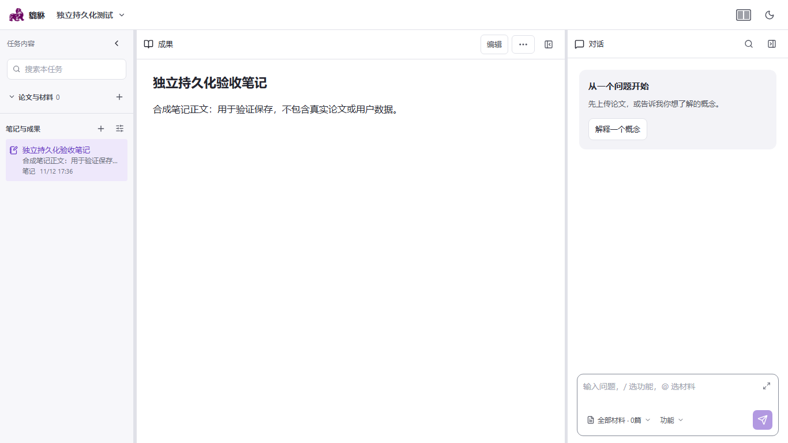

# 真实 Java 笔记持久化验收

当前工作台使用独立 Java 进程和全新 H2 文件数据库，完成合成用户笔记的真实保存、刷新、历史恢复、过期写入保护及服务重启检查。没有修改前端或后端生产源码，没有模型调用，没有写入生产任务。

## 结果

- 浏览器通过真实 Java POST 创建测试任务；界面编辑通过真实 PUT 保存，随后直接 GET 核对正文。
- 清空 localStorage 并刷新后，界面重新从真实 API 读取修改后的正文。
- 在历史版本弹窗恢复原文，界面和 GET 结果一致；被替换的修改稿仍留在历史版本中。
- 使用创建时的旧修订号提交覆盖请求，Java 返回 409，任务标题和正文没有被覆盖。
- 停止并重新启动独立 Java 进程后，任务列表的完整 JSON 与重启前一致：1 个任务、修订号 2、2 条历史版本。
- 最终浏览器案例 1 passed，0 skipped、0 flaky、0 retry；测试后独立服务关闭。



## 范围与复现

测试使用现有 Java JAR，SHA-256 为 `3ac7559375c93118fd6a006112e1c2d2db29b1b954bc996d5ded964c3b3c90b0`。这是该构建与当前前端的集成结果，没有重新构建全部 Java 源码。Java 仅监听 127.0.0.1:8187，Vite 使用独立 4274 端口，数据库位于新建的 tmp 子目录；Python 地址指向不可用的回环端口。浏览器仅转发任务列表/读取/保存，材料、操作列表和能力查询使用明确的无模型夹具，其他 API 与外网请求拒绝。

本轮不证明研究结果生成、研究来源权威字段、真实论文解析或 Python 研究链路。完整 DR0—DR5、独立内容质量和发布验收仍未完成。

可复用脚本会拒绝占用端口和已有运行目录。需已安装前端依赖、Playwright Chromium、可用 Java 与项目 JAR；每次使用新 run-id：

```powershell
.venv-refactor/Scripts/python.exe -X utf8 scripts/run-isolated-task-persistence.py --java <java.exe绝对路径> --jar <项目JAR绝对路径> --run-id <唯一标识>
```

运行器、测试用例分别位于 `scripts/run-isolated-task-persistence.py`、`frontend/tests/e2e/task-persistence-live.spec.js`。默认 E2E 运行不会连接真实后端，此案例只有设置专用隔离地址才会执行。报告位于 `docs/deep-research-evidence/frontend-live-persistence-verified-20261112.json`，原日志和浏览器跟踪位于 `tmp/isolated-persistence-verified-20261112`。

前三轮未通过的测试记录保留：初始测试拒绝了前端默认 localhost API；修正路由后，任务已加载，但默认收起的导航还需显式展开。最终测试设置固定笔记本视口、执行真实展开导航操作，并正确匹配带类型说明的按钮。失败没有通过修改产品行为或降低保存断言消除。第四轮及最终可复用运行器均完整通过。
