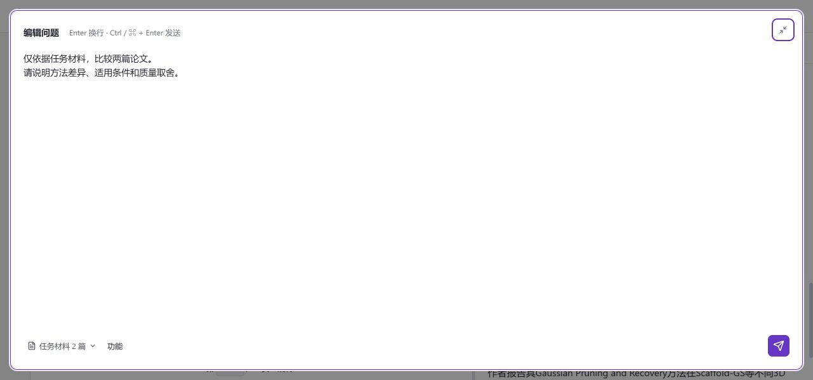

# 输入区与请求状态交互验收

日期：2026-10-11。仅验证前端交互，未提交真实模型请求。

- 输入区右上角可展开全屏编辑，共用草稿、功能与材料选择。全屏 Enter 换行，Ctrl / Cmd + Enter 发送；Esc 收起并返回按钮焦点。发送失败保留可编辑草稿和错误提示。
- 普通输入区两行起步，自动增高并设上限。在 1102×681 窗口中空输入区整体高 100px；任务材料与 @ 材料合并为一个选择入口，键入 @ 仍可使用。
- 当前论文信息收进材料弹层。选中材料后不重复添加引用，长标题标签省略显示并保留完整标题。
- 请求处理中突出状态和停止操作；查询状态放入更多操作，状态未知时保留直接查询。底部只提供“返回当前请求”，不重复展示处理状态。

验证：59 个 Vitest 文件、392 项测试及 19 组 Node 检查通过；类型检查、相关 JSX 静态检查及生产构建通过，保留已有大包体提示。

浏览器验证：1102×681 普通输入区、1280×600 全屏输入、390×640 窄屏。已检查草稿往返、全屏换行、原生模态焦点约束、Esc 关闭材料弹层后再收起编辑、功能菜单位置和窗口缩窄时模态框持续可见。验收后恢复原窗口和空草稿。

